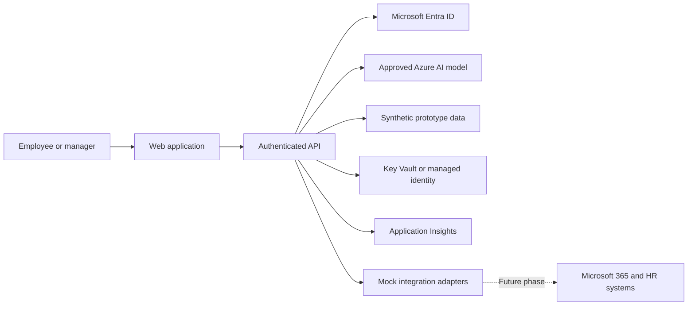

# PFE Assistant Innovation Pod Handoff

## Purpose of this document

This document gives a new project owner enough context to understand, prepare, and deliver the PFE Assistant Innovation Pod without prior involvement.

Use it as the starting point for planning and delivery. The detailed readiness checklist is available in [Innovation_Pod_Readiness_Checklist.pdf](Innovation_Pod_Readiness_Checklist.pdf), and the original concept demonstration is in [PFE Assistant DEMO.mp4](PFE%20Assistant%20DEMO.mp4).

## Executive summary

PFE Assistant is a proposed employee performance and development workspace. It is intended to bring appraisal information, accomplishments, goals, development activities, and manager feedback into one place. An AI assistant helps users draft, summarize, and improve content.

The Innovation Pod is a short, controlled build event to determine whether the most important user journeys are useful and technically achievable. It is not intended to produce a production-ready HR system in one day.

The safest and most productive approach is to:

- Use fictional employee data only.
- Build no more than two or three end-to-end journeys.
- Provide working environments, identities, model access, and starter code before the event.
- Mock Microsoft 365 and HR integrations during the build day.
- Require people to review and approve all AI-generated content.
- Finish with a working demonstration, findings, risks, and a recommendation.

## What “PFE” means in this project

PFE refers to the employee performance evaluation process represented in the concept video. This typically includes documenting accomplishments, completing an appraisal, setting goals, discussing development, and receiving manager feedback.

Confirm the official internal meaning and terminology with the HR or product owner before presenting the project more widely.

## The problem being explored

Performance and development information may be spread across documents, email, conversations, learning systems, and other tools. This can make it difficult for employees and managers to:

- Recall achievements from the full review period.
- Write complete and useful appraisal responses.
- Connect current performance with future development goals.
- Track goals, training, certifications, and feedback together.
- Maintain a consistent view of progress over time.

The concept tests whether a single workspace, supported by responsible AI assistance, can make this process easier and more useful.

## Proposed user experience

### Employee journey

An employee opens their PFE workspace, reviews accomplishments and goals, drafts appraisal responses, and asks the AI assistant to summarize information or identify missing detail. The employee reviews and edits everything before saving or submitting it.

### Manager journey

A manager views direct reports, reviews employee objectives and accomplishments, adds comments, and discusses development actions. The system must prevent a manager from accessing employees outside their authorized team.

### Development journey

An employee records career goals, milestones, training, and certifications so development activity can be discussed alongside performance.

## AI boundaries

AI may assist with:

- Drafting text from facts supplied by the user.
- Summarizing accomplishments or goals.
- Improving clarity and structure.
- Identifying unanswered questions or missing supporting detail.

AI must not independently:

- Assign performance ratings.
- Recommend promotion, compensation, disciplinary action, or termination.
- Make employment decisions.
- Present generated statements as verified facts.
- save or submit content without human confirmation.

Every AI response should be visibly identified as generated content and remain editable by the user.

## Current project assets

| Asset | Purpose | Status |
|---|---|---|
| [PFE Assistant DEMO.mp4](PFE%20Assistant%20DEMO.mp4) | Original concept pitch and application walkthrough | Available |
| [Innovation_Pod_Readiness_Checklist.pdf](Innovation_Pod_Readiness_Checklist.pdf) | Detailed event prerequisites, controls, roles, risks, and sign-off checklist | Available |
| [generate_readiness_pdf.py](generate_readiness_pdf.py) | Rebuilds the readiness PDF when its content or format changes | Available |
| Application source code | Working implementation of the concept | Not present in this folder |
| Architecture decision record | Approved technology and integration decisions | Not yet created |
| Named owner and event date | Accountability and schedule | To be confirmed |

The video demonstrates the idea, not proof that a production-ready system exists.

## Recommended build-day scope

Select no more than three journeys. A sensible minimum is:

1. An employee opens a fictional profile and views accomplishments and goals.
2. The employee drafts an appraisal response with AI assistance and approves the final text.
3. A manager opens an authorized team member and reviews goals or adds feedback.

### Explicitly out of scope for build day

- Real employee or HR data.
- Production deployment or organization-wide rollout.
- Live payroll, compensation, promotion, or disciplinary workflows.
- Automated performance ratings or employment recommendations.
- Broad Microsoft Graph or HR-system integration unless already approved and tested.
- Complete accessibility, localization, disaster recovery, and operational support design.
- Claims that the prototype meets production security or compliance requirements.

## Suggested reference architecture

Key principles:

- Authorization is enforced in the API, not only hidden in the user interface.
- The browser never receives AI service credentials.
- Secrets are never stored in source control.
- Enterprise integrations are placed behind replaceable adapters.
- Logs contain operational details but exclude sensitive appraisal text.
- The application continues to demonstrate core journeys when the AI service is unavailable.

## Minimum tools and environments

The event requires, at minimum:

- A GitHub repository containing starter code and setup instructions.
- Participant access to the repository and package feeds.
- A supported runtime with pinned dependency versions.
- VS Code or an agreed development environment.
- GitHub Copilot licenses if Copilot is part of the event workflow.
- An Azure subscription, resource group, budget limit, and approved AI model deployment.
- Microsoft Entra test identities and a configured application registration.
- A shared test deployment that a named owner can update.
- Synthetic sample records covering employees, managers, goals, and accomplishments.
- Mock services or fixed responses for unavailable enterprise integrations.
- Application diagnostics and a simple way to inspect failures.

## Access and licensing checklist

Complete these checks for every participant before the event:

- [ ] Can sign in to GitHub and clone the repository.
- [ ] Can restore packages through the corporate network or VPN.
- [ ] Can run the starter application locally.
- [ ] Can sign in with the assigned test identity.
- [ ] Can complete a test AI request through the application.
- [ ] Can access the shared test environment.
- [ ] Has an assigned GitHub Copilot license if required.
- [ ] Has the correct Azure role without unnecessary subscription-wide access.
- [ ] Knows who can approve pull requests and deploy changes.
- [ ] Does not depend on pending admin consent, purchasing, or security exceptions.

## Data, privacy, and security rules

Use synthetic data only. Do not copy real appraisal text into source code, prompts, screenshots, chat tools, issue trackers, logs, or demonstrations.

The synthetic dataset should include:

- Fictional names and employee identifiers.
- Employee-to-manager relationships.
- Accomplishments with dates and outcomes.
- Performance goals and progress states.
- Career goals, training, and certifications.
- Examples with missing or incomplete information.
- Separate records that can test unauthorized cross-user access.

Before any governed pilot using real people, obtain approval from HR, privacy, security, legal/compliance, and employee relations as required by organizational policy. Define data ownership, retention, deletion, access review, incident response, and acceptable AI usage.

## People required

| Role | What this person decides or supports | Required availability |
|---|---|---|
| Sponsor | Business priority, funding, and escalation | Kickoff and final review |
| Event lead | Scope, agenda, teams, blockers, and final outputs | Full day |
| Product owner or HR SME | PFE process, terminology, user value, and acceptance criteria | Full day |
| Technical lead | Architecture, interfaces, quality, and technical decisions | Full day |
| Azure/Entra administrator | Resources, roles, identities, model quota, and access failures | Full day or immediate on-call |
| AI engineer | Model integration, prompts, safety, and evaluation | Core build periods |
| Security/privacy SME | Data flows, logging, threat boundaries, and privacy controls | Planning plus review gates |
| UX representative | Employee and manager workflow usability | Core build periods |
| DevOps support | Repository, build, deployment, and diagnostics | Full day or immediate on-call |
| Integration SME | Microsoft Graph, HR, and learning-system constraints | Scheduled office hours |

Record names and contact methods here before the event:

| Responsibility | Named owner | Contact method |
|---|---|---|
| Sponsor | TBD | TBD |
| Event lead | TBD | TBD |
| Product owner | TBD | TBD |
| Technical lead | TBD | TBD |
| Azure/Entra support | TBD | TBD |
| Security/privacy | TBD | TBD |

## Decisions required before preparation begins

- [ ] Name the sponsor, event lead, product owner, and technical lead.
- [ ] Confirm what PFE means internally and which policy/process is being addressed.
- [ ] Set the event date, participant list, team structure, and location.
- [ ] Choose the two or three build-day journeys.
- [ ] Agree measurable acceptance criteria for each journey.
- [ ] Select the implementation stack and hosting approach.
- [ ] Select and approve the AI model, region, quota, and spending limit.
- [ ] Decide whether Microsoft 365 is mocked or live; default to mocked.
- [ ] Approve the synthetic-data schema and AI usage boundary.
- [ ] Define what evidence is required for a proceed, revise, or stop recommendation.

## Pre-event runbook

### Three to four weeks before

- Confirm sponsorship, ownership, participants, budget, problem statement, and success measures.
- Agree the prototype scope and explicit exclusions.
- Begin privacy, security, HR, and architecture review.

### Two weeks before

- Finalize user journeys, wireframes, API contracts, and reference architecture.
- Create the starter repository and synthetic dataset.
- Provision identities, licenses, model access, and the shared environment.
- Create the initial AI prompts and evaluation examples.

### One week before

- Give every participant access and require them to run a verification exercise.
- Test authentication, authorization, AI calls, deployment, telemetry, and reset procedures.
- Confirm SMEs and escalation contacts.
- Prepare mock responses for all external integrations.

### Three days before

- Run the complete event using a clean account and a clean machine.
- Record setup time and resolve every critical blocker.
- Rehearse the demonstration and validate the backup recording process.

### Forty-eight hours before

- Freeze infrastructure and dependency versions.
- Complete the readiness checklist in the PDF.
- Make a formal proceed, reduce-scope, or postpone decision.

### One day before

- Reset synthetic data and verify the shared environment.
- Publish the agenda, team assignments, scope, acceptance criteria, and support contacts.
- Confirm the AI fallback and demo backup are available.

## Build-day runbook

| Timebox | Activity | Required result |
|---|---|---|
| 30 minutes | Kickoff | Shared understanding of scope, architecture, data rules, and acceptance criteria |
| 2 hours | Build block 1 | One thin end-to-end journey running with synthetic data |
| 20 minutes | Checkpoint | Integration test, blocker review, and scope adjustment |
| 2.5 hours | Build block 2 | Priority journeys completed with authorization and AI checks |
| 60 minutes | Validation | Product, usability, technical, privacy, and safety findings recorded |
| 45 minutes | Demonstration and close | Working demo, lessons, risks, recommendation, owners, and next steps |

During the event, the event lead should maintain a visible decision and blocker log. Any problem that threatens the final demonstration should trigger scope reduction before new features are added.

## Definition of success

The session is successful when:

- At least one complete employee journey runs from sign-in through a saved outcome.
- AI assistance is useful, visibly identified, editable, and subject to human approval.
- A manager can access an authorized fictional employee but not an unauthorized one.
- The solution can demonstrate a graceful AI or integration failure state.
- Product and technical assumptions are validated with recorded evidence.
- The team can clearly explain what would be required for a governed pilot.
- A sponsor can make a proceed, revise, or stop decision from the outputs.

The number of features or lines of code is not a success measure.

## Required outputs

The event owner must collect:

- A working prototype and source code.
- Setup, run, test, deployment, and troubleshooting instructions.
- A five-minute demonstration or backup recording.
- Updated architecture and data-flow diagrams.
- AI prompts, evaluation examples, outcomes, limitations, and known failures.
- Security, privacy, and authorization findings.
- A decision and blocker log.
- A prioritized backlog split into pilot and production work.
- A proceed, revise, or stop recommendation with named owners and target dates.

Store these outputs in the repository rather than personal drives or chat threads.

## Main risks and responses

| Risk | Early warning | Response |
|---|---|---|
| Access or admin consent is missing | A participant cannot complete the pre-event test | Provision earlier; use test identities and mocks; postpone if the minimum gate fails |
| AI quota or endpoint failure | Slow, throttled, or failed test requests | Reserve capacity, limit concurrency, and provide deterministic fallback responses |
| Scope expands during the day | Multiple partial screens with no complete journey | Product owner freezes priorities; complete one thin slice before adding work |
| Real HR data appears | Real names or review text enter prompts or screenshots | Stop, remove the data, notify the privacy owner, and follow incident policy |
| AI produces biased or unsupported content | Output invents facts or recommends employment action | Block prohibited uses, require review, and record the failure in evaluation results |
| Frontend and API do not integrate | Teams use different payloads or assumptions | Agree contracts and sample payloads before splitting work |
| Corporate network blocks dependencies | Setup succeeds off-network but fails on participant devices | Test the actual devices and network during the dry run |
| Secrets are shared in source or chat | Credentials appear in a commit, screenshot, or message | Revoke/rotate immediately and use managed identity or secure secret storage |
| Prototype is described as production ready | Controls and integrations are assumed complete | Label the prototype clearly and publish pilot/production exit criteria |

## After the event

Within two business days:

1. Store the code, demonstration, diagrams, findings, and decision log in the repository.
2. Remove temporary credentials, revoke unnecessary access, and confirm data cleanup.
3. Review AI, privacy, security, and technical findings with the accountable SMEs.
4. Convert unresolved work into an owned, prioritized backlog.
5. Publish the sponsor decision and the reason for it.

If the decision is to proceed, define a governed pilot before discussing production. The pilot should have a limited volunteer user group, approved data use, support ownership, monitoring, success metrics, and clear stop criteria.

## Immediate next actions

1. Assign the sponsor, event lead, product owner, and technical lead.
2. Confirm the official PFE process and terminology with HR.
3. Choose the event date and the two or three target journeys.
4. Decide the implementation stack and Azure environment owner.
5. Create the starter application repository and synthetic dataset.
6. Schedule the privacy, security, architecture, and AI reviews.
7. Work through [Innovation_Pod_Readiness_Checklist.pdf](Innovation_Pod_Readiness_Checklist.pdf) and do not schedule the build day until the minimum gate has a credible path to green.

## Glossary

| Term | Plain-language meaning |
|---|---|
| AI model | The service that generates or summarizes text in response to a prompt |
| API | The secured application layer connecting the user interface to data and services |
| App registration | The Microsoft Entra configuration that allows an application to sign users in and request approved permissions |
| Azure AI | Microsoft Azure services used to host or access approved AI models |
| Innovation Pod | A focused, time-limited session for building and validating an idea |
| Microsoft Entra ID | Microsoft's identity service for sign-in, users, groups, and application access |
| Microsoft Graph | An API for approved access to Microsoft 365 data and services |
| Mock | A controlled substitute that behaves like an external service without using the live service |
| PFE | The employee performance evaluation process represented by this concept; confirm the official internal wording |
| Proof of concept | A limited implementation used to test feasibility and value, not a production system |
| Synthetic data | Fictional data designed for testing that does not represent real employees |

---

Document owner: **TBD**  
Last updated: **2026-10-01**  
Status: **Initial handoff for owner review**